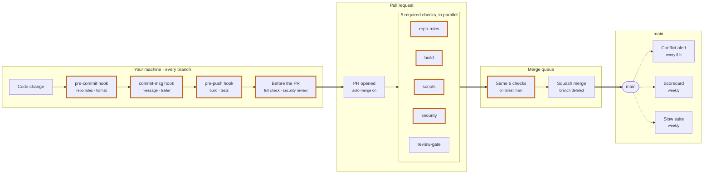

# How a change reaches main

Every change takes the same path. The same script, [`scripts/check.sh`](../../../scripts/check.sh), runs in the local
git hooks and in CI, so a check that passes on your machine passes the same way on GitHub.

An orange outline means a failure stops the change. A dotted line means the job only reports.

| Stage | What runs | Where it's defined |
| --- | --- | --- |
| Hooks | `check.sh pre-commit`, `commit-msg`, `pre-push` | [`scripts/githooks/`](../../../scripts/githooks/) |
| Before the PR | `check.sh full`; the security review for code in its scope | [`CONTRIBUTING.md`](../../../.github/CONTRIBUTING.md#3-run-the-checks) |
| Pull request and merge queue | `repo-rules`, `build`, `scripts`, `security`; `review-gate` from `main`'s copy | [`ci.yml`](../../../.github/workflows/ci.yml), [`review-gate.yml`](../../../.github/workflows/review-gate.yml) |
| After merge | conflict alert, Scorecard, slow suite | [`.github/workflows/`](../../../.github/workflows/) |

These are always on, from the repository settings: SHA-pinned actions from an allowed list
([how to pin one](../how-to/add-or-update-a-github-action.md)), Dependabot, CodeQL, secret scanning with push
protection, and the ruleset on `main`. The ruleset accepts pull requests only, requires the five checks and merges
through the queue.
