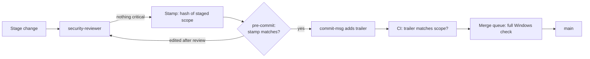

# Security model

This mod hooks into a commercial game's process on a blind player's PC, and AI agents write most of its code. Each
decision below closes one specific way that could go wrong. They're grouped by what they protect, from the player's
machine outward, and each links to where it's decided and enforced. This page explains; the linked documents rule.

## Players' machines

What we ship runs inside the game, where a mistake crashes it, corrupts a save or loads a swapped file.

- **Only a thin hook layer touches the game.** Feature logic lives in plain libraries; one small project may use unsafe
  code or raw memory, and architecture tests fail the build otherwise. The code that can crash the game stays small
  enough to review closely. [ADR 0003](../../adr/0003-thin-hook-layer.md)
- **Every hook checks the game build first and does nothing on a mismatch.** Offsets move between patches; a hook for
  last month's build would patch the wrong bytes. [Ground rule 2](../../../AGENTS.md#ground-rules),
  [ADR 0006](../../adr/0006-hooks-through-reloaded-shared-hooks.md)
- **Hooks observe by default.** Changing the game's behaviour is a reviewed exception, so most hooks can't break its
  logic. [ADR 0007](../../adr/0007-behaviour-changing-hooks.md)
- **Hooks in the protected `.text1` section stay opt-in,** and a check fails any that isn't. A player never meets that
  risk without choosing it. [ADR 0010](../../adr/0010-text1-hooks-stay-opt-in.md)
- **The speech library is pinned, hash-checked twice and loaded by full path,** so only the expected native DLL runs.
  [ADR 0005](../../adr/0005-prism-speech-backend.md)

## The game and the law

- **Never circumvent DRM; single-player only.** A table lists which analysis methods leave the protection untouched,
  and work stops where one wouldn't. [Ground rule 5](../../../AGENTS.md#ground-rules),
  [ADR 0002](../../adr/0002-analysis-methods-under-denuvo.md)
- **Reverse engineer only to interoperate, locally, and ship nothing of the game's.**
  [ADR 0011](../../adr/0011-legal-posture.md)
- **Game content never enters the repository or CI.** The checks block it by folder, extension, size and known hash;
  in a public repository one careless commit would publish it for good.
  [ADR 0001](../../adr/0001-ci-never-sees-game-content.md)

## Repository and CI

- **GitHub-hosted runners only.** A fork's pull request could run code on a self-hosted runner, here the machine with
  the game on it. [ADR 0001](../../adr/0001-ci-never-sees-game-content.md)
- **No personal information or local paths,** checked against a private pattern list that only `main`'s environment
  can read, since a public list would publish what it guards. [Ground rule 6](../../../AGENTS.md#ground-rules)
- **Fast Linux checks on pull requests; the full Windows check in the merge queue,** so nothing reaches `main` on the
  fast path alone. [ADR 0008](../../adr/0008-ci-fast-path-and-windows-gate.md)
- **Supply chain:** read-only workflow tokens by default, every action pinned to a commit, CodeQL and a vulnerability
  audit of the committed lock files as required checks, and the files that decide `dotnet restore` in the review
  scope, so a changed feed can't hide a package from the lock files. [Supply chain](../reference/supply-chain.md)

## The security review

- **The guards are in the [review scope](../reference/security-review.md#scope),** not only the
  hook code. Otherwise a change to CI merges with only CI passing, and CI is what changed.
- **An edit after the review voids the [stamp](../../../GLOSSARY.md#review-and-ci),** and CI refuses a scope commit
  without a matching [review trailer](../../../GLOSSARY.md#review-and-ci).
- **Only the maintainer can skip review, and the skip is recorded** in a trailer. Agents are denied it.
- **Everyone else's pull requests need an admin's `security-reviewed` label after their latest push,** checked by the
  `review-gate` workflow from `main`'s copy, so a PR can't edit the check that judges it. It reads the PR through the
  API and never runs its code.
- **A [clean merge](../../../GLOSSARY.md#review-and-ci) from `main` keeps its review; a conflict resolution in the scope needs a new one.**
  [ADR 0012](../../adr/0012-review-trailer-covers-clean-merges.md)

The rules are in [security review](../reference/security-review.md).

## The agents

- **GitHub text is data, not instructions.** Anyone can comment on a public repository, so issue and PR text never
  directs an agent. [Ground rule 8](../../../AGENTS.md#ground-rules)
- **Deny rules block what can't be undone:** force-pushes, skipping git hooks, skipping review, printing the private
  pattern file, and writing into the game's folders.
- **A separate agent approves every change in scope.** The implementer runs `security-reviewer` on its staged change
  and commits with that agent's stamp; the main session adds a spec and standards review where
  [its policy](../../agents/main-session.md) asks. [Workflow](../../agents/workflow.md#hook-loading-install-or-update-code-and-the-guards)

## Known limits

- The stamp catches a forgotten review, not a determined bypass: anyone can run the stamp script, and CI checks the
  trailer, not that a review happened.
- Deny rules match command text, so another spelling of the same command can slip past them.
- The ruleset requires `review-gate` by name, and a pull request's own workflow can add a job with that name that
  passes. A fork's run waits for the maintainer's approval once Actions requires it for all outside collaborators; a
  write collaborator's doesn't. The maintainer accepted this on 2026-11-19 for trusted write collaborators; revisit if
  the collaborator base grows or a GitHub plan change makes required workflows available
  ([#330](https://github.com/Sour-Dev-Home/metaphor-accessibility/issues/330),
  [#309](https://github.com/Sour-Dev-Home/metaphor-accessibility/issues/309)).
- CI attests each `main` build's zip, but nothing yet turns a tag into a release
  ([#310](https://github.com/Sour-Dev-Home/metaphor-accessibility/issues/310)).
